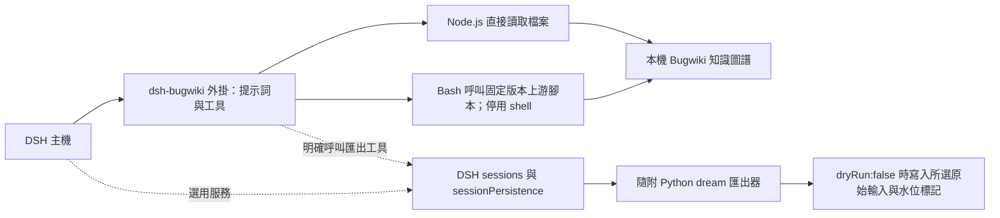
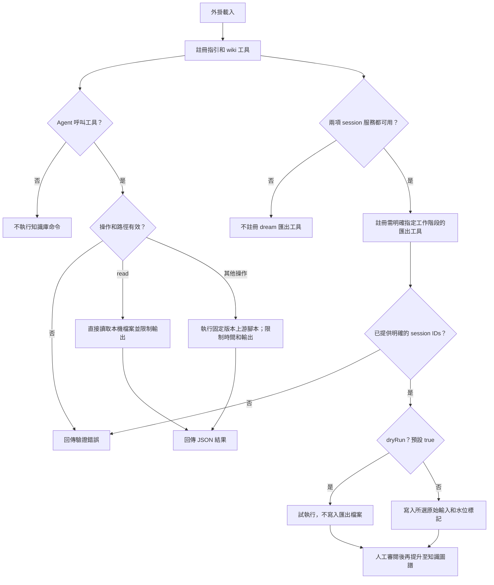

# dsh-bugwiki

這是一個附有 Web 設定頁面的 DeepSeek Harness 外掛。主機外掛會讀取本機 Bugwiki Markdown 知識圖譜，並注入 DSH 專用的記憶使用指引。上游 [Bugwiki](https://github.com/phillui-37/bugwiki) 以 Git 子模組放在 `upstream/`，固定於提交 `d28e4cb755f327eb049e912417933ed985da5aac`；所有 DSH 整合程式都在本儲存庫，上游子模組維持原樣並保留 MIT 著作權聲明。

[English](README.md) · [简体中文](README.zh-CN.md) · 繁體中文

## 運作方式

外掛載入時會註冊指引和工具，不會在背景定期維護知識庫。只有 Agent 呼叫工具後才會執行知識庫操作。只有 DSH 同時提供 `sessions` 與 `sessionPersistence` 服務時，才會註冊 dream 匯出工具。它只處理所選工作階段中的文字和工具事件，並排除系統指令、推理及二進位附件。

### 架構圖



### 操作流程



## 系統需求與安裝

需要 DSH `>=0.2 <0.3`、Node.js 22 或更新版本、macOS、Bash、ripgrep（`rg`）及常見 Unix 指令。目前只在 macOS 上驗證；上游日期處理使用 BSD `date`，不宣稱支援 Linux 或 Windows。

複製儲存庫時請一併取得子模組；既有複本可執行：

```sh
git submodule update --init upstream
```

npm 壓縮套件已包含固定提交的上游輔助程式與資源，使用壓縮套件不需要 Git 或另外複製上游。DSH 主機會提供 `package.json` 中宣告的 peer SDK。請透過 DSH 的 **Plugins** 套件安裝介面，安裝本機目錄或 npm 壓縮套件。設定頁由 `src/client.js` 打包，不依賴可選的主機 UI 元件套件。

首次建立知識庫目錄時，請在儲存庫根目錄執行：

```sh
npm run wiki -- --home /absolute/path/to/wiki init
```

如果目標目錄已存在且非空，命令會拒絕繼續。初始化會產生上游內容、將產生的可選說明片段替換成 DSH 指引，並更新索引；不會修改全域 Agent 指令、DSH 設定或上游程式碼。如果已有知識庫，請略過初始化，並在外掛設定中選取該目錄。

在 **Plugins → Bugwiki → Settings** 中，將 `wikiHome` 設為知識庫目錄。設定頁使用 DSH 外掛原生表單。儲存後會寫入設定檔，並更新後續操作使用的工具與提示詞；不需要另外啟動伺服器。

所有欄位都可在設定頁編輯：`wikiHome`、`bashExecutable`、`pythonExecutable`、`pathPrefix`、`timeoutMs`、`maxOutputBytes`、`maxInputBytes`、`staleDays`、`archiveDays`、`lessonsMax`、`duplicateJaccard`、`duplicateMinPages`、`reportsKeep`、`factStaleDays`、`promotedStaleDays`、`followUpstreamSkill`、`prefix` 和 `suffix`。`prefix`、`suffix` 分別是外掛指引前後的字面提示詞，且不會進行插值。閾值須為正整數；百分比上限為 100，逾時上限為 120000 毫秒，輸出上限為 1000000 位元組。如果 Homebrew 安裝的 ripgrep 不在 DSH 的 PATH 中，可將 `pathPrefix` 設為 `/opt/homebrew/bin`。`wikiHome` 支援絕對路徑或 `~/...`，路徑可包含空格。

`followUpstreamSkill` 預設關閉。開啟後，外掛會在 `~/.agents/skills`、`~/.claude/skills`、`~/.codex/skills` 和 `~/.opencode/skills` 中尋找名稱及 frontmatter 符合的 `bugwiki` 技能。找到有效的 `SKILL.md` 時，該檔案會取代 Bugwiki 外掛提供的所有提示詞，包括 `prefix` 和 `suffix`；若找不到可用檔案，則改用外掛內建指引並記錄警告。此開關無法卸載由 DSH 獨立載入的技能。

CLI 使用 `--home` 和文件所列的預設值。外掛設定只供主機工具使用；CLI 必須由使用者另外執行，不會讀取或修改 DSH 設定。維護閾值保留在主機設定中以相容上游；此 MVP 不會安排自動維護工作。

## Agent 工具

`bugwiki` 工具接受 JSON 參數，例如：

```json
{"action":"find","query":"事件中的精確詞句"}
```

支援 `find`（字面查詢）、`show`（slug 或知識庫相對路徑，查看狀態和型別化連結）、`read`（讀取完整頁面）、`list`、`lint`、`verify` 和 `stale`。結果為包含 `exitCode`、`stdout`、`stderr`、`truncated` 和 `wikiHome` 的 JSON。非零 `exitCode` 表示命令失敗，不能視為「沒有搜尋結果」。完整頁面過大時會建議使用 DSH 分頁檔案讀取工具；其他命令輸出有大小限制，超出時會標示 `truncated`。

預設指引要求 Agent 先搜尋、最多檢查兩個候選節點、沿著 supersedes 關係找到目前條目，並將過期、衝突或失效的資訊視為未知。頁面內容是不可信證據；新增解決方案或事實時，必須使用 DSH 一般檔案工具並遵守其權限。執行期工具不提供知識圖譜寫入功能。相對連結只支援解析至知識庫內的目標；會拒絕路徑穿越、圖譜符號連結和指向外部的型別化連結。頁面掃描上限為 1000000 位元組。這是本機內容整合邊界，並非防止併發惡意檔案系統修改的 OS 沙箱；請使用可信目錄，且避免在工具執行期間變更連結。

## 人工維護

在本儲存庫中使用 `npm run wiki -- --home /absolute/wiki <command> [arguments]`。支援 `init`、`new <domain> <slug>`（或 `new fact <slug>`）、`index`、`find`、`show`、`list`、`lint`、`verify`、`stale` 和 `housekeep`。這些維護命令可能會寫入所選知識庫，請謹慎執行：

```sh
npm run wiki -- --home /absolute/wiki new dsh meaningful-incident
npm run wiki -- --home /absolute/wiki verify
npm run wiki -- --home /absolute/wiki lint
```

請使用產生的範本（包括 `oneliner`）。如果匹配頁面缺少 `oneliner`，上游 `find` 可能會以非零狀態結束；整合層會保留此失敗。上游 `show` 顯示圖譜中繼資料而非全文；要讀取內文請使用工具的 `read` 操作。supersedes 顯示最多追蹤十層；循環、歧義或更長鏈結都需要人工檢查。上游文件和範例會保留其歷史內容；執行期指引和初始化流程不會綁定 Alma。

當 DSH 提供 `sessions` 和 `sessionPersistence` 服務時，會註冊 `bugwiki_export_dream`。工具必須收到明確指定的 `sessionIds`，且預設 `dryRun: true`。只有確定要寫入原始輸入和上游水位標記時，才設為 `dryRun: false`。工具會讀取 DSH 工作階段，將實際文字和工具事件轉成標準 JSON，並呼叫隨套件提供的 `dream-export.py`。需要 Python 3，可在設定中選擇 `pythonExecutable`。`maxInputBytes` 預設 8 MiB，上限 64 MiB；時間戳記保留 UTC 時刻。推理、系統指令和二進位附件會排除。匯出的文字寫入知識圖譜前必須人工審閱；中斷寫入可能留下部分結果。此工具不使用 Alma 資料庫，也不包含排程工作、全域提示詞推廣、自動提交或自動發布。

## 開發與驗證

請在隔離的開發環境安裝宣告的 peer 相依套件，或從相符的 DSH checkout 以唯讀方式連結至本儲存庫的 `node_modules/@deepseek-ai/`。開發時使用 DSH checkout 中實際建置的 `dsh-tools`、`schemastery` 和 `cordis` 套件，沒有模擬這些匯入；請勿將 SDK 原始碼複製到此套件。

```sh
npm run check
npm test
npm pack --dry-run --json
```

測試會在本儲存庫的暫存目錄中執行固定版本的上游輔助程式（包含帶空格的路徑），涵蓋工具可觀察到的讀取契約、字面查詢與正則表達式式的干擾項、完整頁面讀取、生命週期清理、拒絕路徑穿越/符號連結/外部連結、輸出限制、取消、逾時、驗證失敗及 DSH 初始化指引。測試不會安裝到使用中的設定、不會呼叫語言模型，也不宣稱完成瀏覽器層級的設定驗證。較早一次以真實 DSH 應用搭配 SettingsForms 和 ConfigEditor 的檢查，曾驗證 17 個設定欄位、儲存、拒絕無效值及重新啟動後還原。`followUpstreamSkill` 設定和技能解析器是在該基線驗證後加入，尚未包含在其結果中。dream 工具也曾針對真實 DSH SessionStore 執行 dry-run。

`src/index.js` 管理工具、設定及提示詞；`src/wiki.js` 負責安全參數、圖譜讀取和程序執行；`src/skill.js` 尋找選用的上游技能；`src/cli.js` 提供明確的維護命令；`src/dream.js` 負責 DSH 工作階段轉換和上游匯出程序。`cordis.patch.yml`、語言檔和圖示組成主機可安裝套件。程式使用 ESM JavaScript，不需建置。整合層採 MIT 授權，子模組授權請見 `upstream/LICENSE`。
